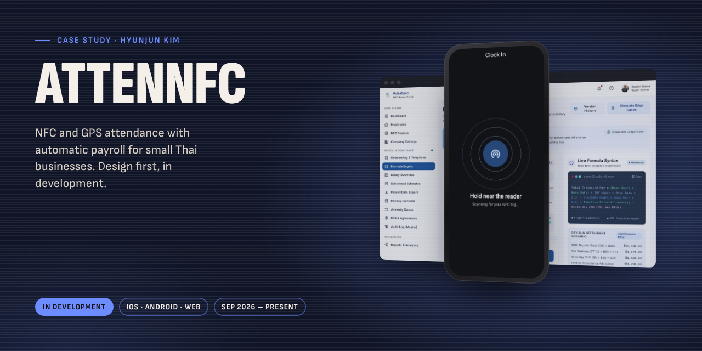
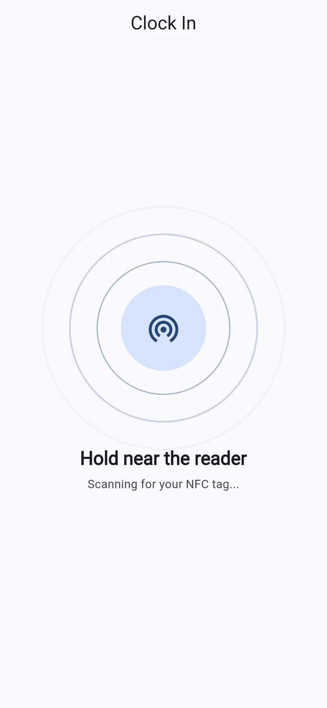
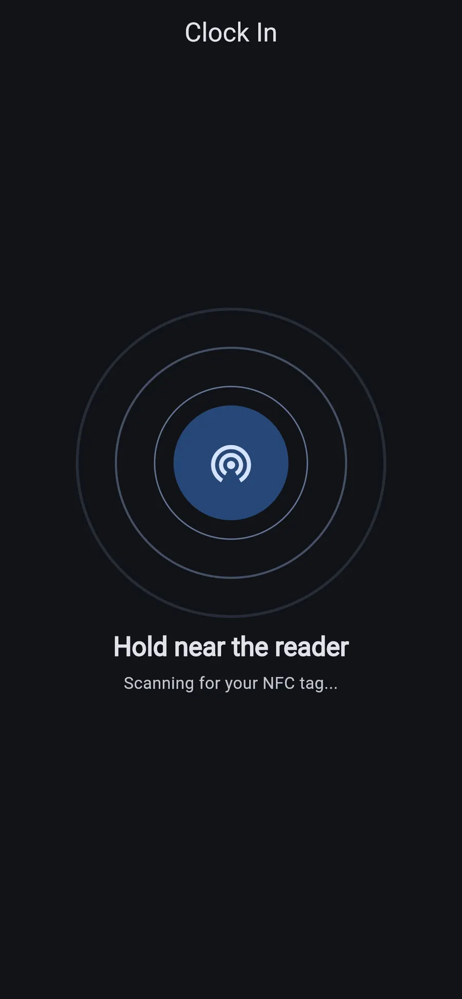
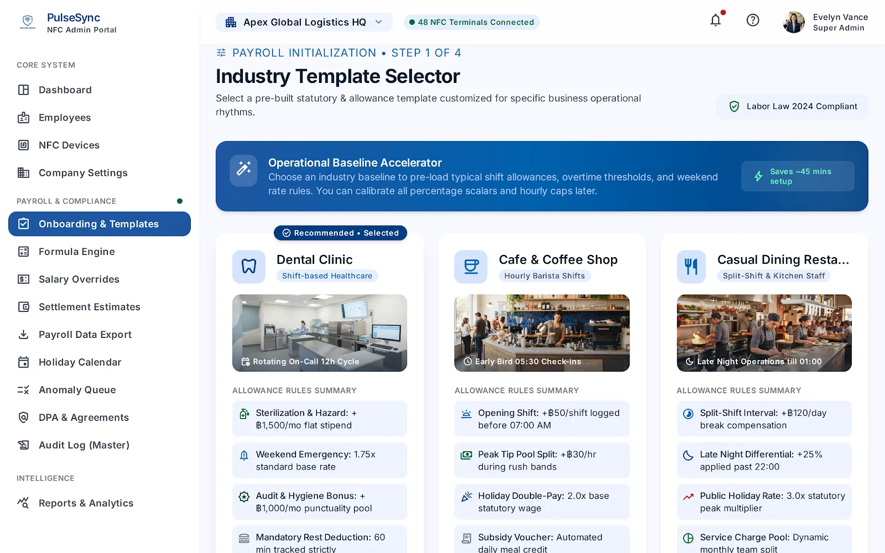
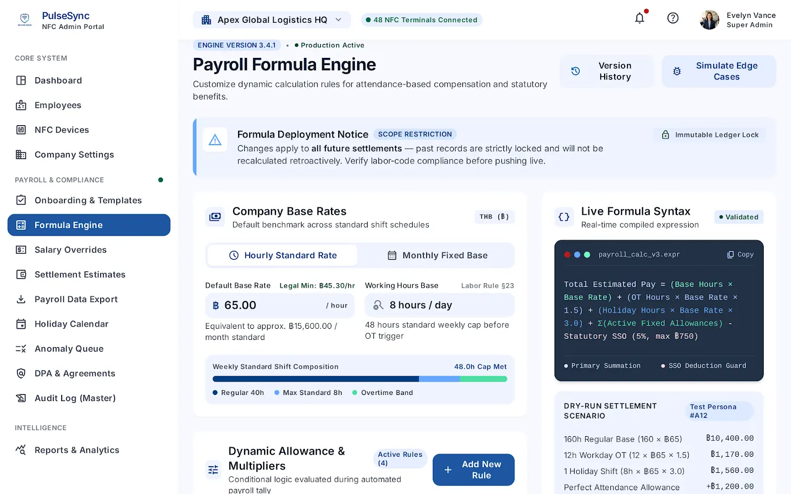
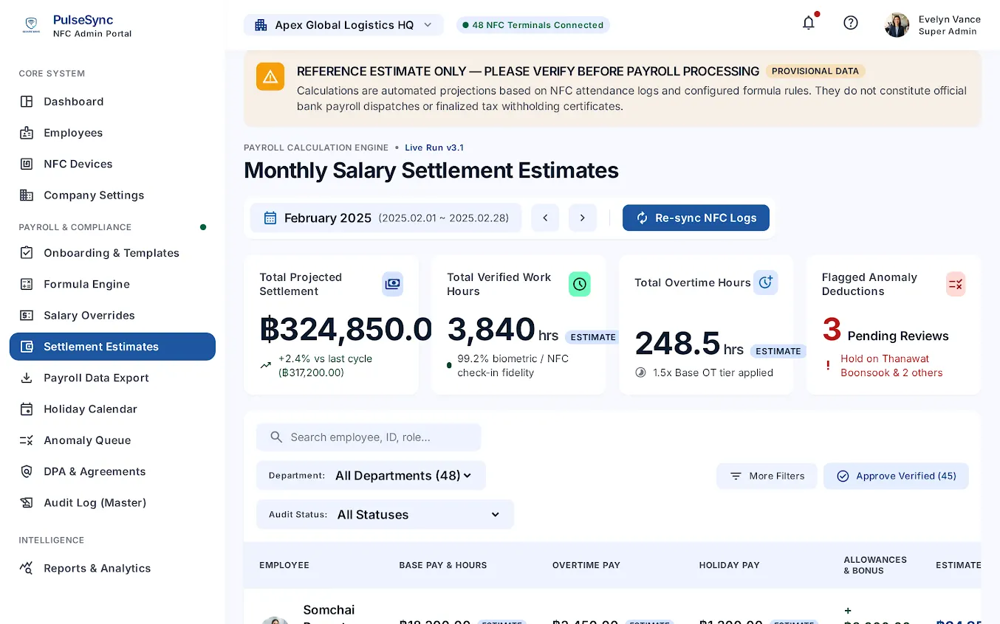
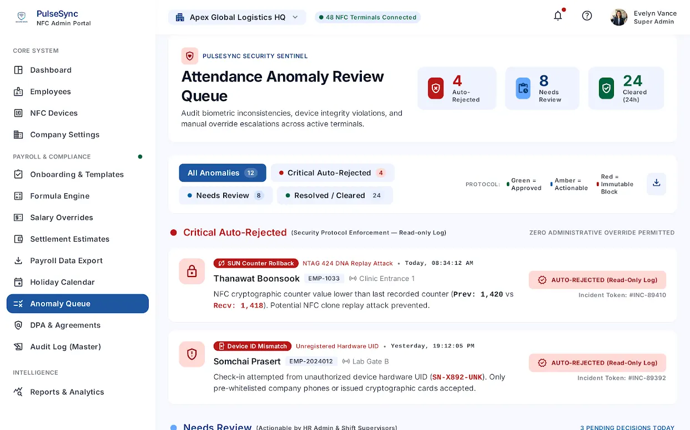
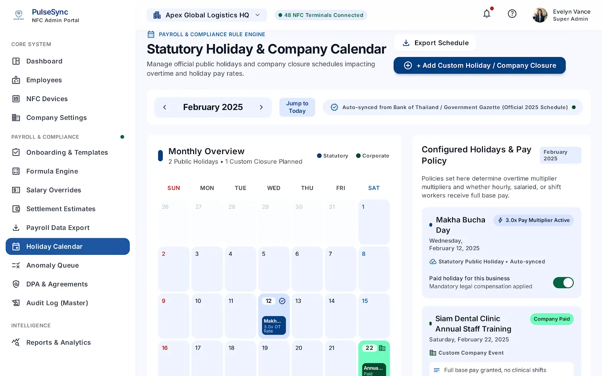
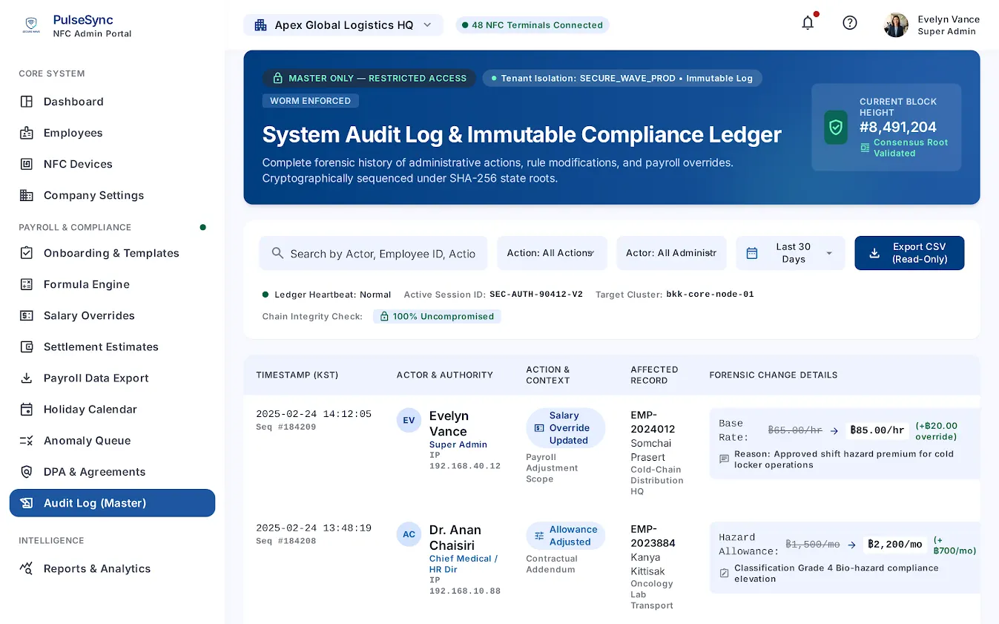
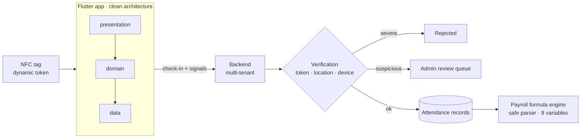

# AttenNFC

NFC and GPS attendance with automatic payroll for small Thai businesses. Design first, in development.

**Status:** In development &nbsp;·&nbsp; **Platforms:** iOS · Android · Web &nbsp;·&nbsp; **Built:** Sep 2026 – present
 [Full case study](https://hyunjunkim.vercel.app/projects/attennfc/)

> [!NOTE]
> This repository is a **case study**, not the source code. The code is private. I'm happy to walk through the codebase live in an interview, or to give a hiring team temporary read access on request.

## The problem

Small Thai clinics, cafés and restaurants track attendance on paper, which invites buddy-punching and time fudging and makes payroll slow. AttenNFC records attendance honestly with NFC tags and location checks, then calculates pay from those records.

## Screens

> Screens below are the product design (made with Google Stitch before coding). The app implements them step by step.

  Clock-in with an NFC tag · Clock-in, dark mode

|   |   |
|:-:|:-:|
|  |  |
| Industry templates | Payroll formula engine |
|  |  |
| Monthly settlement | Anomaly review queue |
|  |  |
| Holiday calendar | Audit log |

## Architecture

## Key decisions

- **Design before code.** Security layers, anomaly rules, payroll variables, data retention and platform limits were written down before any code, because this app moves money and handles location data.
- **Review instead of hard blocks.** Only severe cases (such as a device mismatch) are rejected outright. Everything else is logged for a manager to review, which fits how small businesses actually work.
- **Payroll formulas are configuration.** Managers set formulas on screen and a safe expression parser evaluates them, so a new pay rule needs no new release.
- **Location used for verification only.** GPS and device identifiers are used to verify a check-in and are not kept long term, in line with Thailand's PDPA.

## By the numbers

| | |
|--:|:--|
| **~9 days** | First brief to working core logic |
| **4** | Layers of attendance verification (designed) |
| **9** | Payroll variables, configured rather than hard-coded |
| **5** | Anomaly-detection rules |

## Problems solved along the way

**AI output that missed the spec.** The first generated code had 5 payroll variables instead of 9, a mismatched NFC library API and hard-coded coordinates. Patching kept reproducing the problems, so the schema and design were kept and the code was rewritten from scratch until static analysis reported zero issues.

**iOS Wi-Fi limits.** iOS restricts Wi-Fi access, so the secondary signal can fail. The check falls back to GPS range alone and records that the Wi-Fi step was skipped.

**Changing the phone's clock offline.** True time is estimated from the last server timestamp plus elapsed time, and large differences go to manager review.

## What's next

- Finish one complete flow end to end: sign in, one check-in, verified on the server.
- Tests for payroll formulas first, then CI.
- Translation files and screen-reader labels, screen by screen.

## Stack

`Flutter` · `Dart` · `Riverpod (code generation)` · `Supabase` · `NFC (NTAG424 DNA)` · `math_expressions`

## How it was built

I built this solo, with AI coding agents as my development team. I designed the product, security model and payroll engine, directed the AI agents, reviewed the generated code against the written spec and ordered rewrites where it fell short.

More of my work: [portfolio](https://hyunjunkim.vercel.app) · [all case studies](https://github.com/g326555-lab)

---

© 2026 Hyunjun Kim. All rights reserved. See [LICENSE](LICENSE).
